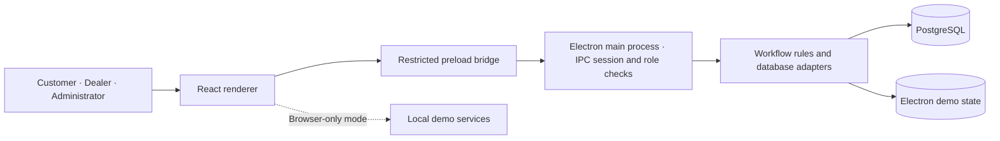
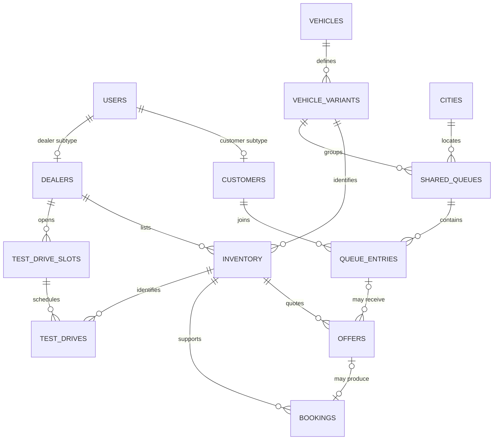

# BestBuy – Multi-Dealer Car Marketplace

BestBuy is an Electron desktop marketplace for Indian passenger vehicles. Customers can compare dealer listings, join a shared queue, respond to offers, and request vehicle bookings or test drives. Approved dealers maintain inventory and appointment availability. Administrators manage marketplace participation and the reference catalogue.

## Project overview

| Area | Implementation |
| --- | --- |
| Target | Desktop application with Windows installer scripts and macOS packaging targets |
| Marketplace | Indian locations, INR amounts and appointment times in India Standard Time |
| Runtime modes | PostgreSQL through Electron, Electron demo mode, and a browser-only demo |
| Architecture guide | [Editable Draw.io workbook](docs/architecture/BestBuy_Architecture.drawio) and [diagram index](docs/architecture/README.md) |

### Problem statement

A customer comparing the same variant across dealerships needs visibility into current prices, queue position, offers, and test-drive availability. Dealers need a way to update their own listings and respond without taking ownership of the shared queue. Administrators need controls for dealer participation, account status and catalogue publication.

### Proposed solution

BestBuy models dealer inventory separately from the reference catalogue and organizes demand by variant and city. Approved dealers can issue offers against matching listings. Accepting a qualifying offer creates a booking with its own locked price and expiry. Test drives reserve dealer appointment slots and keep a separate history.

### Key features

- Search, filtering, comparison, model details, and device-local favourites and recent views.
- Manual Indian location selection, including state–city validation and optional six-digit PIN filtering.
- Shared waitlists, matched offers, direct vehicle bookings, offer-backed bookings and price history.
- Dealer-managed test-drive slots, request decisions, rescheduling, cancellation and completion.
- Customer and dealer moderation, catalogue publishing, reports, audit history and booking-window settings.
- In-app notifications for selected marketplace events, persistent light and dark preferences, and operator-assisted account recovery in PostgreSQL mode.

## User roles and permissions

| Role | Access |
| --- | --- |
| Visitor | Marketplace home and limited listing preview, public registration and sign-in, recovery screens |
| Customer | Browse, compare, manage their own queues, offers, bookings and test-drive requests |
| Dealer | Manage their own profile and access dealership records. Approval gates inventory changes, offer creation and test-drive slot management. |
| Administrator | View users, moderate dealer/customer accounts, remove listings with a reason, manage catalogue publication and booking settings, monitor appointments and access reports and audit records |
| Database operator | Run migrations, bootstrap an administrator, seed demo records and issue password recovery codes using repository commands |

## Technology stack

| Layer | Technologies |
| --- | --- |
| Desktop | Electron 45, Chromium renderer, context bridge and IPC |
| Frontend | React 18, TypeScript, React Router DOM 7 in hash mode, Zustand, Tailwind CSS 3, Lucide React, clsx |
| Build | Vite 8 and TypeScript compiler, electron-builder 26, NSIS |
| Backend | Electron main process, Node.js, Zod and dotenv |
| Database | PostgreSQL via node-postgres, parameterized SQL and versioned SQL migrations |
| Verification | Playwright Core Electron driver, Node assertions and a disposable PostgreSQL schema |
| CI | Manually triggered Windows packaging workflow |

Version ranges come from the [root manifest](package.json) and [client manifest](client/package.json). The Windows workflow selects Node.js 24.

## System architecture overview



[High-level system architecture](docs/architecture/README.md#01-high-level-system-architecture) · [Application components](docs/architecture/README.md#02-application-component-architecture) · [API and data flow](docs/architecture/README.md#09-api-and-data-flow-architecture)

### Application workflow

Public navigation starts at the marketplace home and can preview approved inventory. Sign-in opens the appropriate workspace. The renderer invokes a named preload method for desktop data access. Main-process handlers verify the sender and, for protected operations, recheck the user, role and resource ownership. The adapter returns the result to the renderer for display.

## Frontend architecture

| Module | Responsibility |
| --- | --- |
| [App.tsx](client/src/App.tsx) | Hash routes, role guards, dashboard selection and account checks |
| [Pages](client/src/pages) | Marketplace home, accounts, role dashboards, vehicle details, dealership profile and India features |
| [Layout](client/src/components/layout) and [UI](client/src/components/ui) | Navigation, notifications, account layouts, forms, cards, dialogs and theme controls |
| [Renderer services](client/src/services) | Preload method wrappers and browser-demo fallbacks |
| [Stores](client/src/store) | Persisted renderer auth state and device-local favourites and recent views |
| [Styles](client/src/index.css) | Theme variables, neutral surfaces, control tokens and focus styles |

| Route | Audience and purpose |
| --- | --- |
| `/`, `/login`, `/register`, `/forgot-password`, `/reset-password`, `/role-selection` | Public discovery, account and demo role entry points |
| `/dashboard`, `/settings`, `/test-drives` | Signed-in screens with role-specific behavior |
| `/browse`, `/compare`, `/vehicle/:id`, `/queue`, `/bookings`, `/offers` | Customer marketplace and transaction views |
| `/catalogue`, `/catalogue/:id`, `/garage` | Customer reference catalogue, model details and saved activity |
| `/inventory`, `/dealership` | Dealer workspace |
| `/admin/*`, `/admin/catalogue` | Administration and catalogue management |

## Backend architecture

| Module | Responsibility |
| --- | --- |
| [IPC handlers](electron/ipcHandlers.ts) | Sender validation, session handling, authorization and operation dispatch |
| [Adapter contract](src/database/IDatabaseAdapter.ts) | Shared desktop operations implemented by PostgreSQL and mock adapters |
| [PostgreSQL adapter](src/database/adapters/PostgresDatabaseAdapter.ts) | Account, inventory, queue, offer, booking, notification and admin operations |
| [SQL projections](src/database/adapters/postgresQueries.ts) and [validation](src/database/validation.ts) | UI-shaped query responses and input schemas |
| [India marketplace service](src/services/indiaMarketplace.ts) and [stores](src/database/indiaStores.ts) | Catalogue, manufacturer publication, appointment rules and persistence |
| [Domain services](src/services) | Pricing, booking transitions, demo queue allocation, INR/IST formatting and admin metrics |

There is no separately deployed HTTP API in the current implementation. Core PostgreSQL workflows and transaction boundaries live in the adapter. The India marketplace service also runs against the local demo store.

## Electron desktop architecture

[Main process](electron/main.ts) creates the sandboxed BrowserWindow, selects and connects its adapter, registers trusted IPC handlers, and serves the built client or a local development renderer. [Preload](electron/preload.ts) runs in an isolated context within the renderer process and exposes a named `window.electronAPI` bridge. The renderer has context isolation enabled and Node integration disabled.

Desktop demo catalogue and test-drive state use a JSON file in the Electron user profile. Core mock accounts and inventory are held in memory. Browser-only mode keeps its own demo data and local-storage state. It cannot reach the database through the desktop bridge.

## Database architecture

The schema is `bestbuy`. Node-postgres manages connections from Electron main. SQL projections convert relational rows and JSONB details into TypeScript-facing results.

| Migration | Purpose |
| --- | --- |
| [001_initial.sql](src/database/migrations/001_initial.sql) | Accounts, geography, listings, price history, queues, offers, bookings, notifications and audit logs |
| [002_india.sql](src/database/migrations/002_india.sql) | Reference catalogue, test-drive slots and requests, and marketplace booking-window setting |
| [003_marketplace_identity.sql](src/database/migrations/003_marketplace_identity.sql) | INR defaults, owned demo-seed registry and recovery-code storage |

The [migration runner](src/database/migrate.ts) creates `schema_migrations`, acquires a transaction advisory lock, applies pending versions, and populates the reference catalogue during migration 002. Migration 003 preserves existing monetary amounts and leaves them unclassified. INR-restricted queries exclude records that have no confirmed currency.

### Database ER diagram

The following excerpt shows the primary sales and appointment relationships. The [complete ER view](docs/architecture/README.md#03-database-er-diagram) includes the schema’s accounts, locations, operational tables, key columns and composite foreign keys.



A queue's dealer participation comes through matching stock and offers. It has no dealer ownership column. The reference catalogue stores descriptive JSONB independently of the canonical `vehicles` and `vehicle_variants` used by inventory. `audit_logs.target_id` and `demo_seed_records.record_id` have no foreign keys to their targets.

## API architecture and important endpoints

These endpoint names are Electron IPC channels declared in [ipcHandlers.ts](electron/ipcHandlers.ts) and exposed through [preload.ts](electron/preload.ts). Most operations return `{ success, data?, error? }`. Some commands return a specialized payload or status.

| IPC channels | Access and purpose |
| --- | --- |
| `auth:register`, `auth:login`, `auth:logout`, `auth:resetPassword` | Trusted-renderer account actions with PostgreSQL recovery support |
| `auth:getUserById`, `auth:getAllUsers` | Self lookup and administrator user listing |
| `vehicles:preview` | Public, bounded summary of matching Indian dealer listings |
| `vehicles:getAll`, `vehicles:getById` | Signed-in inventory reads with role and ownership checks |
| `vehicles:create`, `vehicles:update`, `vehicles:updatePrice`, `vehicles:updateAvailability`, `vehicles:delete` | Approved dealer inventory operations. Moderated deletion is also available to administrators. |
| `dealers:getAll`, `dealers:getById`, `dealers:update`, `dealers:updateStatus` | Dealer profile, approval and account management |
| `queue:join`, `queue:getPosition`, `queue:leave`, `queue:getByCustomerId`, `queue:getAll` | Customer queue actions and scoped monitoring |
| `offers:create`, `offers:accept`, `offers:updateStatus`, `offers:getByCustomerId`, `offers:getByDealerId`, `offers:getAll` | Dealer quoting, authorized customer acceptance or decline, and role-scoped reporting |
| `bookings:create`, `bookings:updateStatus`, `bookings:getByCustomerId`, `bookings:getByDealerId`, `bookings:getAll` | Direct booking, status progression and scoped reads |
| `notifications:getAll`, `notifications:markRead` | Signed-in user's inbox and read state |
| `admin:getStats`, `admin:getAuditLog`, `admin:updateCustomerStatus`, `vehicles:getPriceChanges` | Administrator oversight |
| `india:operation` | Signed-in catalogue and appointment command dispatcher |
| `app:usesDatabase` | Renderer mode detection |

The India dispatcher accepts `catalogue`, `saveCar`, `setManufacturerActive`, `settings`, `setSettings`, `drives`, `dealerSlots`, `setSlot`, `availability`, `request`, `reschedule` and `changeStatus`. Catalogue or settings mutations require administrator access. Customers operate on their own appointments, while approved dealers operate on their assigned requests and slots.

## Authentication and authorization flow

1. Public registration accepts customer and dealer roles. Administrators are bootstrapped through a database operator command.
2. Electron authentication uses salted scrypt. The browser demo uses local PBKDF2 helpers for its simulated accounts.
3. On success, Electron main stores a session tied to the sending WebContents with a 12-hour expiry. The renderer persists the returned user and token for UI state. IPC uses the sender session for authorization.
4. Protected requests reload account state and enforce scope, ownership and dealer approval as applicable. The renderer also checks account state while the authenticated layout is open.
5. Logout clears the main-process session and local auth state. Closing the WebContents or restarting the desktop process invalidates its in-memory session.
6. An operator issues a 30-minute recovery code. PostgreSQL stores its SHA-256 digest, and successful redemption consumes the code and replaces the password hash in the same transaction.

[Authentication diagram](docs/architecture/README.md#04-authentication-and-authorization-flow) · [Password hashing](src/database/passwords.ts) · [Recovery implementation](src/database/passwordRecovery.ts)

## Customer workflow

Register or sign in, choose an Indian location, discover models or listings, inspect the vehicle and compare dealers. Join a matching queue, request a test drive, or create a direct booking. When a dealer sends an offer, accept or decline it from the customer workspace. [Customer workflow diagram](docs/architecture/README.md#05-customer-workflow)

## Dealer workflow

Register a dealership and its showroom, maintain the profile, and wait for administrative approval. An approved dealer can select catalogue models and variants, publish and update stock and pricing, review matching enquiries, send offers, manage bookings, and open or close available test-drive slots. [Dealer workflow diagram](docs/architecture/README.md#06-dealer-workflow)

## Admin workflow

Admin screens cover overview, dealers, customers, listings, queues, reports, marketplace demand and pricing, and the audit log. Administrators can approve, reject or suspend dealers; suspend customers; remove listings with a reason; manage catalogue models and manufacturer publication; monitor test drives; and change the booking-window setting.

## Shared vehicle queue workflow

PostgreSQL resolves one city from eligible inventory, then creates or finds the queue for `(variant_id, city_id)`. The join transaction reuses an existing active entry or increments `last_position` and assigns the new ordinal. A partial unique index allows one active entry per customer and queue. A cancelled position is not renumbered. Leaving cancels the entry and expires its pending offers. [Queue diagram](docs/architecture/README.md#07-shared-vehicle-queue-workflow)

## Dealer offer and booking workflow

- Offer creation verifies an approved dealer's listing against the customer's active queue, including variant and city. The offer records the quoted and original listing prices and its expiry.
- Acceptance creates a purchase booking and stores the locked price and expiry atomically. It marks the queue entry booked and expires other pending offers for that entry. Decline creates no booking and can restore the entry to waiting when no live offers remain.
- Direct bookings use an eligible listing and validate a supplied price against its current price. Both paths create a pending booking. The transition policy permits authorized progression through confirmation, payment-pending and booked where applicable, with completed, cancelled and expired terminal states.
- Test-drive records refer to a listing but have an independent lifecycle. [End-to-end diagram](docs/architecture/README.md#11-end-to-end-booking-lifecycle) · [Booking transitions](src/services/bookingTransitions.ts)

## Test-drive booking workflow

An approved dealer publishes slots in IST. Customers select a listing, enter contact details and request a future open slot within the configured booking window. The request initially awaits confirmation. The assigned dealer can accept or reject it before the appointment, and complete a confirmed drive once its start time passes. Customers can cancel before the start or reschedule to a free slot, which returns the request to requested status. Changes append history.

The PostgreSQL India store serializes writes using an advisory transaction lock. A partial unique index on dealer, day and slot prevents duplicate occupancy for requested, confirmed and completed records. [Test-drive diagram](docs/architecture/README.md#08-test-drive-booking-workflow)

## Location and Indian vehicle catalogue architecture

[Location data](src/data/indiaLocations.ts) provides a country-specific state and city registry for manual discovery and dealer registration. Dealer addresses and canonical cities persist in PostgreSQL. The reference seed contains 14 manufacturers and 88 Indian-market models. Each catalogue record holds its body type, trims, indicative prices and specifications. Actual dealer stock and quotes come from separate inventory and offer records. [Reference catalogue](src/data/indiaCatalogue.ts) · [Indian demo fixtures](src/data/indiaDemo.ts)

## Light and dark theme implementation

Light mode is the initial preference. The theme toggle persists in Zustand and sets the document's `data-theme` attribute. CSS variables drive neutral typography, surfaces, borders and actions. Tailwind maps its neutral utility ramp to those variables. Favourites and theme selection are local to the device. [Theme toggle](client/src/components/ui/ThemeToggle.tsx) · [Tailwind configuration](client/tailwind.config.js)

## Installation and setup

Use Node.js 24 and npm. From the repository root, install both dependency sets and build:

```bash
npm ci
npm ci --prefix client
npm run build
npm start
```

The default adapter is `mock`. For PostgreSQL, prepare the private environment file and provision the schema before starting the desktop application. [Database operations guide](DATABASE.md)

### Environment variable configuration

Use the private, ignored `.env` at the repository root for development. Packaged Electron reads `.env` from its user-data directory. Launcher environment variables take precedence. [Environment template](.env.example)

```dotenv
DATA_ADAPTER=postgres
DATABASE_URL=
```

| Variable | Purpose |
| --- | --- |
| `DATA_ADAPTER` | `mock` or `postgres` |
| `DATABASE_URL` | PostgreSQL connection URL, supplied privately |
| `BESTBUY_ENV_FILE` | Optional private config path for database scripts |
| `BESTBUY_ADMIN_EMAIL`, `BESTBUY_ADMIN_NAME`, `BESTBUY_ADMIN_PASSWORD` | Operator inputs for administrator bootstrap |
| `BESTBUY_DEMO_PASSWORD` | Operator-supplied password for demo-seed accounts |
| `BESTBUY_TEST_EXECUTABLE`, `BESTBUY_AUDIT_SHOTS` | Optional executable override and screenshot directory for the desktop test |

### Database migration and seeding

```bash
npm run db:migrate
npm run db:create-admin
```

Supply the administrator variables privately before running bootstrap. Use a separate demonstration database for transactional demo data.

```bash
npm run db:migrate
npm run db:seed:india
```

The seed requires a password of at least 12 characters. Stable keys and a registry make reruns skip owned records. Use a database identity with schema-creation rights for migrations and the live verification script, and a restricted connection for normal use.

For operator-assisted account recovery:

```bash
npm run db:recovery -- account@example.com
```

### Development commands

| Command | Purpose |
| --- | --- |
| `npm run dev` | Start Vite and the Electron development app together |
| `npm run dev:client` | Run the browser-only Vite frontend |
| `npm run dev:electron` | Compile and launch Electron using the local development workflow |
| `npm run build:client` | Type-check and bundle the React frontend |
| `npm run build:electron` | Compile Electron and shared backend TypeScript |

### Production build

```bash
npm run build
npm start
```

Vite writes `client/dist/`. The root TypeScript compiler writes `dist-electron/`. Electron-builder packages both into `release/`. [Build and deployment diagram](docs/architecture/README.md#10-deployment-and-build-architecture)

### Windows installer generation

```bash
npm run dist:win
npm run dist:win:arm64
npm run build:win
```

These commands target the x64 NSIS installer, ARM64 NSIS installer and unpacked x64 application respectively. The installer filename is configured as `BestBuy-Setup-<version>-<arch>.exe`. The repository also configures `npm run dist:mac` for DMG and ZIP artifacts. Signing depends on the build environment. [Windows workflow](.github/workflows/windows-build.yml)

## Project folder structure

```text
BestBuy/
├── assets/                    Desktop icon resources
├── client/
│   ├── src/components/        Shared UI, layout, analytics
│   ├── src/pages/             Public, customer, dealer and admin views
│   ├── src/services/          Renderer wrappers and browser demo
│   └── src/store/             Local auth and garage state
├── electron/                  Main process, preload and IPC
├── src/
│   ├── data/                  India catalogue, geography and demo fixtures
│   ├── database/              Adapters, PostgreSQL commands and migrations
│   ├── services/              Shared domain rules
│   └── types/                 Shared data contracts
├── scripts/                   Desktop and PostgreSQL verification
├── docs/architecture/         Editable architecture workbook and guide
└── DATABASE.md                Database setup and operational guidance
```

## Testing and validation

| Command | Implemented test coverage |
| --- | --- |
| `npm run test:desktop` | Playwright Electron checks for navigation, auth, role workflows, search, pricing, queues, notifications, themes, test drives and admin management |
| `npm run db:verify` | PostgreSQL integration checks in a generated disposable schema, including migrations, concurrency, seed repeatability, recovery and IPC authorization |
| `npm run build` | Renderer type checks and bundling, plus Electron TypeScript compilation |

The PostgreSQL verification script cleans up its own schema. Use a non-production database for test runs. The Windows CI workflow packages and exercises the unpacked x64 executable. [Desktop test source](scripts/verify-desktop.cjs) · [Database test source](scripts/verify-postgres.cjs)

## Security considerations

- Electron enables context isolation and sandboxing, disables renderer Node integration, and blocks unexpected navigation, webviews and new windows.
- The IPC layer checks the trusted main frame, session, account state, role and resource ownership as applicable. Renderer route guards provide navigation control.
- Database access uses TLS certificate verification and parameterized queries. Database credentials belong to the main process and operator scripts.
- Operator recovery codes are short-lived, stored as digests and redeemed transactionally. Delivery requires an approved operator channel.
- Direct database credentials are available to whoever controls the installed machine. The current PostgreSQL desktop model is appropriate for managed installations. A public deployment needs a backend service that holds database credentials off customer devices.

## Known limitations

- Reference prices and trim specifications are indicative. Some models lack verified imagery and current specifications.
- Browser-only mode is a local demo. Electron demo accounts and inventory reset with the mock adapter.
- Recovery depends on an operator-issued code. Automated email or SMS recovery, payment processing and precise geolocation are absent.
- Historical amounts with unclassified currency require an operator review before they can appear in INR views.
- Packaging configuration alone does not establish installer signing or platform verification.

## Future enhancements

Possible extensions include a server-side API for public installations, verified catalogue and media feeds, automated recovery delivery, and payment-provider integration. These are design opportunities outside the current implementation.

## Screenshots

| Planned capture | Status |
| --- | --- |
| Marketplace landing and comparison | Screenshot placeholder |
| Customer booking and light/dark navigation | Screenshot placeholder |
| Dealer inventory and administrator reports | Screenshot placeholder |

The desktop verification script can capture selected views when `BESTBUY_AUDIT_SHOTS` points to a writable directory.

## Contributors and license

The root package identifies **BestBuy Automotive Marketplace** as the author. Contributor attribution is available through repository history. The package declares **ISC**. The working tree has no standalone license file, so the manifest is the available license metadata. [Package metadata](package.json)
